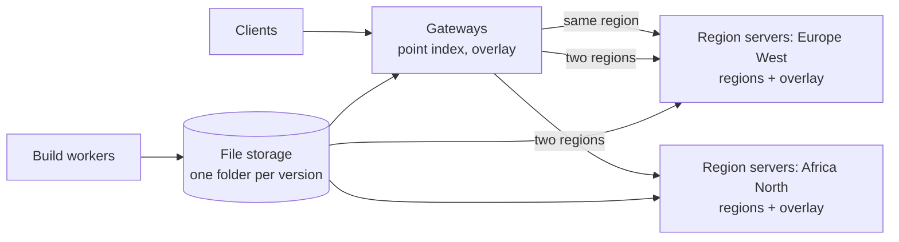

# The whole world, with many queries at the same time

!!! note "Status"
    Design only. No code for this page exists yet. The numbers for the world are **estimates** from the France
    measurements ([The preparation tile by tile](build-by-tile.md)). The steps at the end of this page measure them.

This page describes how tileroute can serve routes for the whole world to many users at the same time. It has two
parts:

1. A change to the hierarchy. Without this change, the world does not work on any number of computers.
2. The distribution: shards, servers, the query between shards, the build and the updates.

## 1. Why today's design does not work for the world

Today, the cell of a node is an XYZ tile. A set of zoom z holds the road edges that cross the borders of the zoom-(z + 1)
tiles inside one zoom-z tile. The borders are straight lines, so each set holds every road that crosses its lines.

| | France (measured) | World (estimate: about 60 times the roads of France) |
|---|---|---|
| Road edges (nodes) | 25.9 million | about 1,500 million |
| Top nodes (level 7 and coarser) | 28,192 | about 1.7 million |
| `top.trt` | 794 MB | more than 50 GB |
| All tile files | 8.1 GB | about 500 GB |
| Read for each query | 31 MB, 5.3 ms | more for long routes |

The size is not the worst problem. All nodes of one set have the same rank, so the search moves through a set as a plain
Dijkstra does. The zoom-1 set holds every road that crosses the Greenwich meridian or the equator: tens of thousands of
nodes in the UK, France, Spain, Algeria, Mali, Ghana and other countries. A long query goes through such sets.
More computers do not make a set smaller. So the first change is to the cells.

## 2. The change: cells from the graph, not from straight lines

**The rule.** The cells must be nested (each cell is in one parent cell) and the cells of one level must not overlap.
The method needs nothing more: the proof that two nodes of one level in different cells have no arc between them uses
only these two properties. A cell does not have to be a square.

**The change.** A graph partition gives the cells. It cuts the road network where few roads cross: the sea, mountains,
rivers with few bridges, the edge of a city. Then a set holds only the few roads across its cut.

| | Today | With cells from the graph |
|---|---|---|
| Cell | an XYZ tile | a part of the road network, made by the partition |
| Children of a cell | 4 | 2 or more (the partition decides) |
| Level and cell of a node | the smallest tile that holds both ends | the smallest cell that holds both ends (the same rule) |
| Set steps, witness search, arc reduction, query | as today | unchanged |
| A set of the top | every road across a straight line | only the roads across the cut |

**The partition.** Inertial flow, written in Rust:

1. Put the junctions of the cell in order along a line (for example west to east), from their coordinates.
2. Take the first 25% as the source side and the last 25% as the target side.
3. Find the minimum cut between the two sides (maximum flow).
4. Do steps 1 to 3 for 4 lines (west-east, north-south and the two diagonals), and keep the smallest cut.
5. Do the same for each half, until a cell has fewer junctions than a limit.

Inertial flow uses the coordinates, as the tiles do. On road networks, its cuts are almost as small as those of the
best partition programs. The partition depends only on the network, not on the costs. So a new cost (traffic) does not
change it.

**What the XYZ tiles still do.**

| Use | Why the tiles stay |
|---|---|
| Find the road edge of a point | a tile index from a point to its road edges is fast and simple |
| The browser | it reads the files with HTTP range reads, by tile |
| Small cells | the finest levels can stay tiles: a tile of zoom 16 or finer cuts few roads |

**What we must measure first.** On Kentucky and France: the size of the largest set, the top nodes, the arcs that a
query opens and the query time. The target: no set larger than a few thousand nodes, and France below 2 ms for each
query.

## 3. Shards: regions and the overlay

A coarse level of the partition gives the **regions**, for example cells of about 20 million to 50 million road edges.
France is about one region. The world has about 50 regions.

| Part | Holds | Size (estimate, to measure) |
|---|---|---|
| A region | all nodes finer than the region level, with their arcs and saved paths | 5 to 20 GB for each region |
| The overlay | all nodes of the region level and coarser: the roads across the region cuts | about 1 GB for the world, if the cuts are small |
| The point index | from a point (tile) to its road edge and its region | a few GB |

The overlay is small only with cells from the graph. With straight tile borders, the overlay is the 50 GB top.

**Each server holds one or more regions and a full copy of the overlay.** So a server can answer every query with both
ends in its regions, also when the best route leaves the region and comes back: the forward search goes up from the
start to the overlay, and the overlay is complete on each server.

## 4. The query

**Step 1, at the gateway.** Find the road edge and the region of the start and of the end, from the point index.

**Step 2: both ends in one region.** Send the query to one server of that region. It runs the query as today and
returns the route.

**Step 3: the ends in two regions.**

1. The gateway sends two requests at the same time:
    - to a server of the start region: the forward search from the start, up to the overlay. The answer is a list of
      (overlay node, cost).
    - to a server of the end region: the backward search from the end, up to the overlay. The answer is a list of
      (overlay node, cost).
2. The gateway runs the bidirectional search in its copy of the overlay. It starts from the two lists.
3. The result is the cost and the chain of arcs. The cost is exact.

**The path.** A shortcut of the overlay can pass through other regions. Its inner nodes are in the files of those
regions. To get the road edges of the route, the gateway sends each part to a server of its region, and these servers
unpack their parts at the same time. Many clients need only the travel time (for example a table of travel times).
For those clients, the gateway does not unpack.

| Query | Network calls | Work |
|---|---|---|
| Both ends in one region | 1 | one search, as today |
| Ends in two regions, cost only | 2 at the same time | two searches up to the overlay, one search in the overlay |
| Ends in two regions, with the path | 2, then 1 for each region on the route | as above, then the unpack |

## 5. Many queries at the same time

| Method | What it does |
|---|---|
| Threads | A query only reads the files. Each thread has its own labels (as today), so a server with k cores runs k queries at the same time. |
| Copies of regions | Each region is on 2 or more servers. Regions with more queries (large cities) get more copies. A load balancer sends each query to a free copy. |
| Tables of travel times | A request for many starts and many ends uses one forward search for each start and one backward search for each end, then joins them in the overlay (the bucket method). This costs about (starts + ends) searches, not starts × ends. |
| Cache of searches | The upward search of a busy place (an airport, a station) is kept for some minutes, for each cost version. |
| Gateways | They hold no state except the overlay and the point index, so more gateways give more capacity. |

**A first estimate of capacity.** If a query takes about 1 ms of one core (the target of section 2), one core answers
about 1,000 queries per second. 10,000 queries per second need about 10 cores for the searches, and more for the
network and the unpack. The memory, not the processors, decides the number of servers: about 500 GB of files, two
copies of each region.

## 6. The build and the updates

The build runs on many workers, as the build tile by tile runs on one computer today.

| Phase | Where | Work |
|---|---|---|
| 1. Partition | one computer, or one worker for each continent | the cells of all levels; only when the road network changes |
| 2. Region steps | one worker for each region, all at the same time | the steps of all levels finer than the region level (today's build tile by tile) |
| 3. Overlay steps | one computer | the steps of the region level and coarser, on the overlay |
| 4. Files | one worker for each region | the arc reduction of the region together with the overlay, then its files |
| 5. Publish | file storage | a new folder for each version |

**New costs (traffic).** The decision from [Updates](updates.md) stays: rebuild all costs on a schedule, with the same
structure. Phases 2 to 5 run again; the partition stays. With 50 workers, the region steps of the world take about as
long as France takes on one computer today (about 4 minutes), and the overlay steps must be measured.

**A new version.** Servers load the new version next to the old one. A query uses one version from start to end: the
gateway puts the version number in each request. When all servers have the new version, the old one is removed.

**One region changes** (new roads in it). Its region steps and its files run again. The overlay steps run again only
when the roads across its cut change.

## 7. Failures

| Failure | Result |
|---|---|
| A region server stops | The load balancer sends its queries to another copy of the same region. |
| A gateway stops | The clients use another gateway. All gateways are equal. |
| The build of a new version fails | The servers keep the old version. |
| A region has no server | Queries with an end in that region fail. Queries that only pass through it give the cost, but not the path. |

## 8. The steps

| Step | Work | Done means |
|---|---|---|
| D1 | Inertial flow partition in Rust; cells from the partition for the levels above a tile zoom | Kentucky and France: routes equal to duckOSM's router; the largest set, the top nodes, the arcs opened and the query time measured against today's table |
| D2 | Regions and the overlay in files; the query between two regions in one process | the same routes as one hierarchy; the overlay size measured for France split into regions |
| D3 | Region servers and a gateway as separate processes on one computer, then on two computers | the same routes; the time of the two network calls measured |
| D4 | Europe: build on several workers | build time, overlay size and query time for Europe |
| D5 | A load test | queries per second for each server; time for 50%, 99% of the queries |

D1 is the condition for all other steps: if the sets stay large, the distribution does not help.
