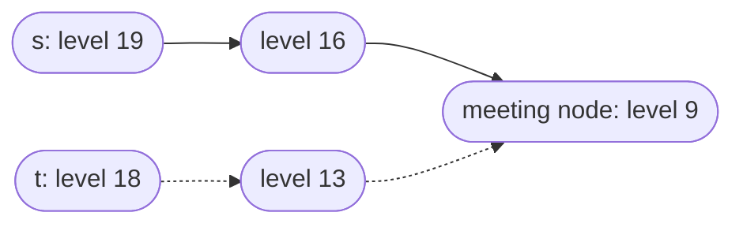

# The shortest path

## The search

A query has a start node `s` and a target node `t` (two duckOSM `edge_id`s). tileroute runs two Dijkstra searches at
the same time:

| Search | Starts at | Uses the arcs and shortcuts `a → b` where |
|---|---|---|
| Forward | `s` | `level(b) ≤ level(a)`: toward a node of the same or a coarser level |
| Backward (on reversed arcs) | `t` | `level(a) ≤ level(b)`: the same rule, seen from `t` |

So each search only goes **up**: from short streets to longer roads, from small tiles to large tiles. It can also move
between nodes of the same level, which are in the same tile.

Each node that both searches reach gives a candidate: (distance from `s`) + (distance to `t`). The best candidate is
the shortest path. The searches stop when the smallest distance in both queues is not smaller than the best candidate.

## Why the result is correct

Take a shortest path from `s` to `t`. Look at its inner node `v` with the finest level. Its run of neighbours on the path
with the same level is one set X (same level, same tile). The nodes just before and after that run are coarser, so the
step for X made a shortcut between them with a cost that is not larger. Put it in place of the run. Do this again until
no inner node is finer than its two neighbours on the path.

Now the levels on the path go up from `s` to a top, stay there in one tile, and go down to `t`. The forward search
finds the part from `s` to the top, and the backward search finds the part from `t` to the top. This is the standard
proof of a contraction hierarchy.

## Unpack

The path of the search can have shortcuts. Each shortcut `u → w` saves its **inner nodes**: the nodes of the removed
set X on its path (on average 1.7, at most 15 on Kentucky). The unpack replaces the shortcut with `u → x1 → … → w`.
Each step of that list is an arc of the input graph or a finer shortcut, which is unpacked in the same way, down to the
arcs of the input graph. This needs no search, only lookups.

The saved list stays valid: the arcs to the nodes of a set never change after its step, because all later steps only
add shortcuts between coarser nodes. The unpacked path has exactly the cost of the shortcut, because each sum is exact
([The graph](graph.md#the-cost-of-a-path)). The output is the list of duckOSM `edge_id`s.

## How the query is made fast

| Part | What it does | Kentucky, one query |
|---|---|---|
| First version | labels in hash maps, node numbers in the order of the database rows, unpack with a Dijkstra | about 10.5 ms |
| Saved inner paths | the unpack reads the saved nodes, with no search | 7.3 ms |
| Node numbers by level | the top nodes, which a query reads most, are together in memory | 4.0 ms |
| One array of (cost, node) for each search graph | a search reads one stream of memory for the arcs of a node | 3.2 ms |
| No stall-on-demand | its extra reads cost more than it saves on this hierarchy | 2.35 ms |
| Arc reduction ([Shortcuts](shortcuts.md#arc-reduction-fewer-arcs-for-the-search)) | arcs that another path in the same search graph makes not needed are removed from the search graphs | **1.09 ms** |

All times: one thread, the WSL PC, 2,000 pairs. The labels of a search are flat arrays that the next query of the same
thread uses again; a stamp marks which entries belong to the current query.

## Equal to duckOSM's router

| Check | Result |
|---|---|
| Monaco, all 7,645,225 pairs | each path and each cost equal to duckOSM's router |
| Kentucky, 10,000 random pairs | each path equal, 0 wrong |
| Somerset, Burnaby, Vancouver city, Metro Vancouver, 10,000 pairs each | 0 wrong |

When two different paths have exactly the same cost (a **tie**), duckOSM's router takes one by its heap order, and
tileroute can take the other one. The check counts each tie and makes sure that the costs are equal. Monaco and
Kentucky have no ties; the four older Vancouver-area databases have 12 to 77 ties in 10,000 pairs.
