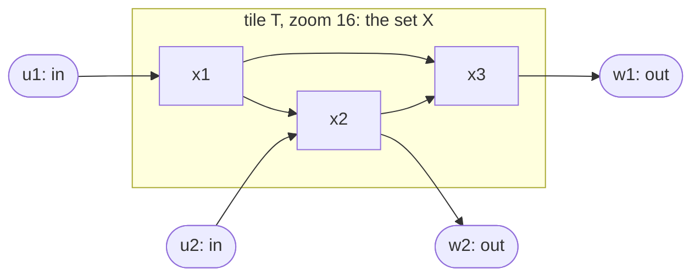

# Shortcuts

## What a shortcut is

A shortcut is an arc that tileroute adds to the graph. A shortcut `u → w` has the cost of a shortest path from `u` to
`w`, so a search can go from `u` to `w` in one step. The nodes between `u` and `w` are not on the shortcut; tileroute
finds them again when it writes the path ([The shortest path](query.md#unpack)).

## How tileroute makes the shortcuts

tileroute goes from the finest level (20) to zoom 1. At each zoom `z`, it does one step for each tile `T` of that zoom:

1. **The set X:** the nodes of level `z` with cell `T`. These are the road edges that cross the borders between the
   children of `T`. The road edges of finer levels in `T` are already removed (at finer zooms).
2. **The nodes u:** each node that is not removed and not in X, with an arc into X.
3. **The nodes w:** each node that is not removed and not in X, with an arc out of X (`w` ≠ `u`).
4. **The shortcut u → w:** its cost is the cost of the shortest path from `u` to `w` whose inner nodes are all in X.
   tileroute runs one Dijkstra from each `u`, only on the nodes of X.
5. **Keep it** only if there is no arc `u → w`, or if the shortcut is cheaper than that arc.
6. **Remove X.** The later steps do not use the nodes of X. Their arcs and the shortcuts stay in the graph for the
   query.

A node `u` or `w` is not removed yet, so its level is coarser than `z`. It touches `T` (it has a common junction with a
node of X), so it is a road edge that **crosses the border of T**: one end in `T`, the other end outside.

## Example

Tile `T` at zoom 16. The nodes of level 16 in `T` are `x1`, `x2` and `x3`. The streets inside the children of `T` (level
17 to 20) are already removed. Two coarser roads come into X (`u1`, `u2`), and two go out (`w1`, `w2`).



The step makes at most 2 × 2 = 4 shortcuts: `u1 → w1`, `u1 → w2`, `u2 → w1`, `u2 → w2`. Each one has the cost of the
shortest path through X. Then `x1`, `x2` and `x3` are removed.

## Why both ends of a shortcut are outside X

A shortest path that goes **through** X comes in from some `u` and goes out to some `w`. The shortcut `u → w` gives
that part of the path in one step. So the shortcuts of all steps together let a search jump over each tile that the
path only goes through.

A path that **starts or ends** in X does not need a shortcut from an inner node. The original arcs between the nodes of
X stay in the graph, and the search walks on them to the border of X ([The shortest path](query.md)).

A shortcut with one end inside X (`x → w`, as in h3-routing-platform) is also possible. Then a search can leave the
start cell in one step, but the number of shortcuts grows by about (nodes in X) × (border nodes) for each cell.
[Comparison with h3-routing-platform](comparison.md) shows the difference.

## Witness search: skip the shortcuts that are not needed

Before a step adds the shortcut u → w (cost c, through X), it looks for a **witness**: another path from u to w that
does not go through X and costs c or less. If a witness exists, the shortcut is not needed, because a query can use the
witness, and the step does not add it.

```
          X (removed now)
   u ──→ x1 ──→ x2 ──→ w        through X: 60 s
   │                    ↑
   └────→  y  ─────────┘        a witness, outside X: 55 s, so no shortcut u → w
```

| Rule | Why |
|---|---|
| The witness search is a Dijkstra from u, only on nodes that are **coarser than the zoom of the step** (not removed, not in any set of this zoom) | Two sets of the same zoom run at the same time. If X used a node of another set X′ as a witness, and X′ used a node of X, both could skip the same shortcut, and a route would be lost. |
| It stops when its distance is more than the largest c of u's shortcuts, or after a fixed number of settled nodes | A limit only keeps a few shortcuts that are not needed; it never skips a needed one, so the routes stay exact |
| A witness with the **same** cost is sufficient | the query finds a path of the same cost |

The witness search makes the preparation longer and the hierarchy smaller: fewer arcs at the top, so a query opens fewer
arcs. Which shortcuts are needed depends on the costs, so a rebuild with new costs runs the witness search again
([Updates](updates.md)); the list of all pairs (`Hierarchy::pairs`) stays the list of candidates.

**Result** (Kentucky, one thread): the witness search skips 7.6 million of 17.3 million shortcut pairs, but the arcs of
the hierarchy go down only from 15.96 to 15.29 million, the arcs that a query opens from 581,951 to 536,028, and the
query from 7.3 to 7.0 ms; the preparation takes 21 s in place of 15 s. At the top (zoom 6, 7) only the few hundred
nodes of zoom 5 are coarser, so a witness is seldom found there, and the dense top stays.

**A core (`--core Z`) does not help either.** If the steps stop at zoom Z and the coarser nodes stay as one graph, the
query must search that graph with a plain Dijkstra, and the graph still holds the shortcuts that the finer steps made
between its nodes:

| Core (Kentucky) | Nodes settled | Arcs opened | One query |
|---|---|---|---|
| none | 4,181 | 536,028 | 6.9 ms |
| zoom 6 | 4,227 | 528,114 | 6.9 ms |
| zoom 8 | 7,166 | 765,559 | 11.6 ms |
| zoom 10 | 23,617 | 909,539 | 26.4 ms |
| zoom 12 | 90,320 | 1,284,001 | 60.0 ms |

The cause of the dense top is the order: each set joins all its in-nodes to all its out-nodes, and the large tiles
have many roads across their borders. A classic contraction hierarchy avoids this with an order by importance.

**A classic order for the top (`--top-ch Z`) does not help either.** The tile steps run down to zoom Z + 1; then the
nodes of zoom Z and coarser are removed one at a time in the order of importance (as OSRM and GraphHopper do), in
parallel rounds of nodes that do not touch each other:

| Classic order from (Kentucky) | Preparation | Arcs opened | One query (one thread) |
|---|---|---|---|
| none (tile order only) | 21 s | 543,097 | 2.33 ms |
| zoom 6 (1,333 nodes) | 53 s | 455,320 | 1.95 ms |
| zoom 8 (6,581 nodes) | 758 s | 502,553 | 1.98 ms |

The top nodes are already joined by many shortcuts from the finer tile steps, so a classic order on them makes as many
shortcuts again. The routes stay exact (Monaco: all pairs), but the gain is small and the preparation is much longer.
So the tile order stays for all levels.

## Arc reduction: fewer arcs for the search

After the steps, many arcs of the two search graphs (forward and backward) are not needed: another path in the same
search graph costs the same or less, for example u → x → w in place of the shortcut u → w. A small Dijkstra from each
node (in parallel, at most 2,000 settled nodes) finds these arcs and removes them **from the search graphs only**; the
unpack data keeps every arc. A search then uses the other path, so the routes stay exact.

| Kentucky | Before | With arc reduction |
|---|---|---|
| Arcs that a query opens | 543,097 | **180,380** |
| One query (one thread, WSL PC) | 2.35 ms | **1.09 ms** |
| Query data | 802 MB | 747 MB |
| Preparation | 21 s | 34 s |

A larger limit (20,000 settled nodes) removes no more arcs.

## Why the tiles of one zoom run in parallel

Two sets X of the same zoom have no common node and no arc between them: their road edges are in different tiles and
have no common junction. A step reads the graph and writes only new shortcuts, so tileroute runs all tiles of one zoom
on all threads, then adds their shortcuts.

## The result for each zoom (Kentucky, driving)

| Zoom | Nodes of this level | Shortcuts made |
|---|---|---|
| 20 | 250,780 | 577,152 |
| 17 | 376,176 | 1,148,536 |
| 14 | 160,255 | 927,767 |
| 11 | 26,537 | 655,667 |
| 8 | 3,241 | 334,815 |
| 6 | 360 | 60,138 |
| 5 | 973 | 0 (the top: no step) |

Kentucky has 2,149,438 nodes and 5,645,321 arcs. tileroute makes 10,318,657 shortcuts in 13.8 s
([Measurements](../reference/measurements.md)).

!!! info "The name of this method"
    This is a contraction hierarchy (as in OSRM and GraphHopper) whose order comes from the tiles: a node of a lower
    level is higher in the hierarchy. A plain contraction hierarchy removes one node at a time; tileroute removes a
    whole set X at a time.
