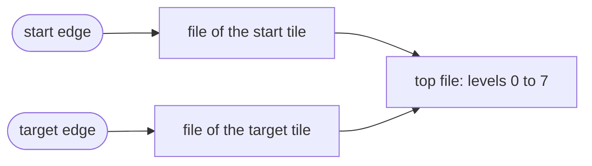

# Tile files: the approach

This page tells why tileroute stores the hierarchy in tile files, and how the writer and the query work. The file
format and the measurements are in [Tile files (reference)](../reference/tile-files.md).

## The problem

The query data of Kentucky is about 800 MB in memory. A continent has about 100 times more road edges, so a process
that keeps all of it in memory needs tens of GB. But one query uses only a small part of the hierarchy: the nodes near
the start, the nodes near the target, and some nodes of low level between them. The goal: a query reads only the
tiles that it needs.

## The idea in four rules

| Rule | Why |
|---|---|
| A node goes to the file of the zoom-8 tile that holds its cell. The nodes of level 7 and lower go to one top file. | The fine nodes near the start and the target are in one or two files. Almost each query needs the top nodes, so they are together. |
| A node number is the same in all files. The nodes of one file are one range of numbers. | An arc keeps the plain number of its other node. The file of a node is a binary search in a short list. |
| The arcs of a node are in the file of that node. | When the search settles a node, it needs one file only. |
| The query maps a file only when its search settles a node in that file. | Files far from the route are never read. |

## How the writer works

`tileroute build` first makes the hierarchy in memory, as `tileroute check` does. Then it writes the files:

1. For each node, it finds the file: the top file if the level is 7 or lower, else the zoom-8 ancestor of the cell.
2. In each file, it sorts the nodes by level, then by cell. The nodes that a query reads together are then near each
   other on disk.
3. It gives the new node numbers: file after file, in this order.
4. For each node, it writes the arcs of the forward search, the arcs of the backward search, and all arcs with the
   inner nodes of the shortcuts. Each arc gets the new number of its other node.
5. It writes `edges.idx` (the duckOSM `edge_id`s, sorted, with their node numbers) and `index.bin` (the range of
   numbers of each file).

All numbers are little-endian, and each section starts at a multiple of 8 bytes. The reader maps the file into memory
and uses the arrays directly, with no step that decodes them.

## How a query works

1. `edges.idx` gives the node numbers of the start edge and the target edge.
2. The two searches run as in memory ([The shortest path](query.md)). When a search settles a node, the query finds
   the file of that node and maps it, if this query did not map it before.
3. The unpack replaces each shortcut with its saved inner nodes. It reads the files along the route.
4. The output is the `edge_id` of each node on the path, from the files.

The labels of a query are in hash maps, not in arrays with one place for each node. So the memory of a query depends
on the number of nodes that it reaches, not on the size of the area. This makes the query about 10% slower on
Kentucky (2.6 ms against 2.4 ms in memory).

## Why these choices

| Choice | Other possibility | Why this one |
|---|---|---|
| Files of zoom 8 | zoom 6 or zoom 10 | Zoom 8 is the tile size of duckOSM builds and pbfcut. Kentucky has 18 files; a query reads 3.7 on average. |
| One top file for levels 0 to 7 | one file for each coarse tile | The top is small (Kentucky: 3,340 nodes, 47 MB) and almost each query reads it. |

!!! note "The partition version"
    With `--partition 16`, the top file holds levels 0 to 2 (`--top Z` changes this). The other files are the cells of
    level 3 (`build --by-tile`), or the zoom-8 XYZ tiles (`build --xyz-files`, in memory): the order of the nodes and
    the files are two separate choices. See [Cells from the graph](partition.md#files).
| Global node numbers | a local number and a tile key for each arc | 4 bytes for each arc, and no step that changes numbers during the search |
| Memory map | read the file into memory | The operating system reads only the pages that the query touches, and keeps them in its cache for the next query |
| A cache of 64 open files | keep all files open | The memory stays limited when an area has thousands of files |

## The difference from the first design

The first design ([design.md](https://github.com/Khoshkhah/tileroute/blob/main/docs/design.md), sections 4 and 5)
kept an overlay table of costs between the border nodes of each tile. The hierarchy changed since then: it is now a
set of shortcuts between nodes, ordered by level. So the files keep the shortcuts and their inner nodes, not overlay
tables, and a query does the same search as in memory.

## Limits

| Limit | Effect |
|---|---|
| A dense city makes a large file (Louisville: 246 MB) | A query in that city maps a large file. Files of a finer zoom in dense areas can fix this. |
| Each arc is stored three times (forward, backward, all) | The files are larger than necessary |
| A query reads 8.8 MB on average | Most of it is the arcs of the nodes of low level, which have many shortcuts |
| There is no archive of the folder yet | The browser cannot read the files yet (milestone M8) |
