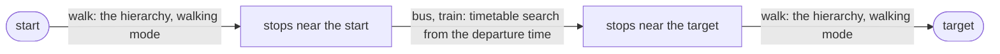

# Timetable: trains and buses

!!! note "Status: plan, not built"

## Why a timetable is different

A road arc has one cost: "37 s", at any time. A bus has no fixed cost: it depends on the **departure time**.

| You are at stop A at | You arrive at stop B at |
|---|---|
| 08:00 | 08:12 |
| 08:05 | 08:12 (you wait for the same bus) |
| 23:30 | 06:20 the next day |

A shortcut over a bus line would need a function of the departure time, not one number. Such time-dependent hierarchies
exist, but their shortcuts become large tables and their preparation is heavy. So the timetable does **not** go into the
shortcut hierarchy.

## The design: three parts, joined at the stops

| Part | Method | Data |
|---|---|---|
| Walk to the stops | The walking hierarchy: from the start to all stops in a walking distance, in one search | duckOSM walking graph |
| Vehicles | RAPTOR on the timetable, from those stops at (departure time + walking time) | GTFS (stops, routes, trips, times) |
| Transfers between stops | Walking times between near stops, made one time with the walking hierarchy | stored with the timetable |
| Walk from the stops | The walking hierarchy: from the stops to the target | duckOSM walking graph |

## Why RAPTOR

| Method | Preparation | Query | Criteria |
|---|---|---|---|
| CSA (Connection Scan) | sort all departures by time | one scan from the departure time | arrival time |
| **RAPTOR** | group the trips into routes | rounds: 0 transfers, 1 transfer, 2 transfers, ... | arrival time **and** number of transfers |
| McRAPTOR | as RAPTOR | as RAPTOR, with more labels | more criteria, for example walking time, fare |

RAPTOR gives "the fastest trip with 0, 1, 2 transfers" in its normal run, which is what transit apps show. McRAPTOR
adds the query weights of [Weights](weights.md) (walking time, number of transfers, waiting time) as criteria. Both need
no shortcuts: a new timetable needs only a new sort, so it can be updated each day.

## What the hierarchy must do for this: one to many

Today the query goes from one node to one node. The timetable needs:

| Query | Use |
|---|---|
| One to many | from the start to all stops near it |
| Many to one | from all stops near the target to the target |
| Many to many | the walking transfers between near stops (one time, in the preparation) |

A contraction hierarchy does these well: one upward search from the start, then one downward pass over the stops
("bucket" method). This is new code in tileroute.

## Tiles

The stops get tile keys like all nodes. The timetable is stored by region: a trip inside one region reads only the
departures of that region and of the regions on the way. The rule of one tiling protocol stays.

## Checks

| Check | Rule |
|---|---|
| Walking parts | equal to duckOSM's router (walking), as today |
| Timetable part | equal to a plain time-dependent Dijkstra on the same GTFS data, for random stops and times |
| Door to door | equal to a plain search on the full graph (walking + timetable), for random pairs and times |
