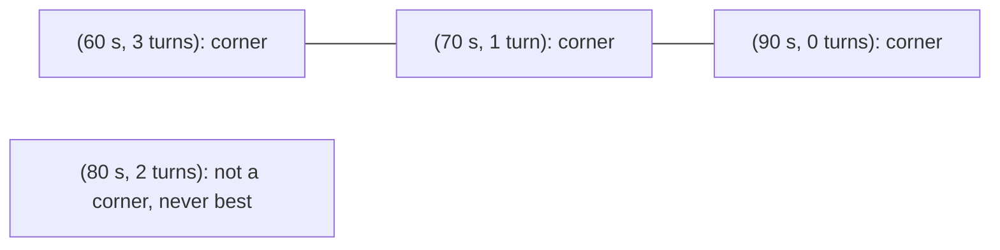

# Weights: a cost made of many items

!!! note "Measured: a cheap estimate"
    The best of a few routes (one metric for each cost type and a mix) is a cheap estimate: on Kentucky its mean
    error is 0.3% or less with three candidates, the largest 8.4% ([Weights for each query](customization.md#weights-for-each-query-the-best-of-a-few-routes)).

!!! note "Status: plan, not built"
    This page is the design. The code today has one cost for each arc (the travel time).

## The goal

Each query brings its own weights for the items of the cost, for example:

```
cost(arc) = a × time + b × left turns + c × traffic lights + d × length
```

The user chooses a, b, c, d (for example with sliders), and the route must be the best route for these weights, with
no new preparation for each query.

## The items (features)

Each arc of the edge graph is one move from a road edge into the next one at a junction, so each item is a number on
an arc:

| Item | Value on the arc `e → f` | Source |
|---|---|---|
| Time | the travel time of road edge `e` | `edge_graph.cost` (today) |
| Length | the length of road edge `e` | `edges.length_m` |
| Left turn, right turn, U-turn | 1 if the move from `e` to `f` is that turn, else 0 | the angle between `e` and `f` at the junction |
| Traffic light | 1 if the junction of the move has a traffic light | OSM `highway=traffic_signals` |
| Other (slope, surface, road class) | a number for each road edge | `edges` columns |

All items must be **0 or more**, and the weights must be **0 or more**. Then the cost of an arc is never negative, and
Dijkstra and the hierarchy stay correct.

duckOSM must give these items as columns of `<mode>.edge_graph` (one column for each item), so that tileroute only
reads them. Today duckOSM gives the time; the turn types and the traffic lights are new columns.

## The vector of an arc and of a path

The **vector** of an arc is its items, for example (time, left turns, lights) = (37.2, 1, 0). The vector of a path is
the sum of the vectors of its arcs. For weights λ = (a, b, c), the cost of a path is λ · (its vector).

## Why one number for each shortcut is not enough

A shortcut u → w stands for the best path from u to w through its tile. But "best" depends on the weights:

| Weights | Best path from u to w | Its vector (time, left turns) |
|---|---|---|
| time only | a short street with 3 left turns | (60 s, 3) |
| time + 30 s for each left turn | a longer main road with no left turn | (90 s, 0) |

So a shortcut must keep **more than one** vector.

## Which vectors a shortcut keeps: the lower hull

Draw the vectors of all paths from u to w through the tile. For linear weights (λ ≥ 0), only the corners of the lower
convex hull of these points can be best:

- a path that is not a corner is never the best for any weights, because a mix of two corners is always at least as
  good;
- so each shortcut keeps only the corner vectors.



For 2 or 3 items, a shortcut usually has 1 to 5 corners (to be measured).

## The preparation

The same tiles, the same levels, the same steps as today ([Shortcuts](shortcuts.md)). Only the step for a set X
changes:

| | Today (one cost) | With vectors |
|---|---|---|
| Arc value | one number | a list of corner vectors |
| Step for X | one Dijkstra from each u through X | for each pair (u, w): the corners of the paths through X |
| How | Dijkstra | **2 items:** start with the best path for the first item and for the second item; between two known corners, run one Dijkstra with the weights that make them equal; a new corner appears, or the hull is complete. **3 items or more:** the same idea on the faces of the hull. |
| Kept | the cheapest pair cost | all corners of each pair (u, w); **every pair is kept**, also when a direct arc is cheaper for some weights |

The shortcut places do not depend on the weights, so the structure is made one time. The vectors depend on the items:
when the items change (for example a new traffic time), the vectors are made again ([Updates](updates.md)).

## The query

The same search as today. The cost of an arc for this query is:

```
cost(arc) = min over its corner vectors v of (λ · v)
```

The search keeps one number for each node (as today), so the query time grows only with the number of corners of the
arcs it reads. To unpack a shortcut, the query uses the corner that gave its cost and finds that path in the tile with
the same weights.

## The check

For random weights λ, each route must equal duckOSM's router on the same graph, with the arc cost = λ · (arc vector).
This is the same rule as today: 0 wrong routes.

## What it costs (to be measured)

| Measure | Expected |
|---|---|
| Corners for each shortcut | 1 to 5 for 2 items, more for 3 items |
| Preparation | some times the time of today (a few Dijkstras for each step instead of one) |
| Memory and tile size | about (corners × items) numbers for each shortcut instead of one |
| Query | about the same search, with a little more work for each arc |

## Fixed profiles

A fixed profile ("fastest", "few turns") is only a fixed λ. It needs nothing more: the query uses the same vectors with
that λ. So option B also covers the profiles.
